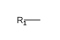
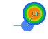
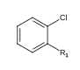

# Rust

| Crate | Role |
| --- | --- |
| [`xpict`](https://crates.io/crates/xpict) | Public API (`mol` / `render` / `depict`) |
| [`xpict-core`](https://crates.io/crates/xpict-core) | Shared layout + paint (Chematic + CoordGen) — used by WASM / PyO3 |

```toml
xpict = "0.1"
# or paint-only:
xpict-core = "0.1"
```

## Single molecule

```rust
use xpict::{mol, MolRenderOptions};

let mut benzene = mol("c1ccccc1")?;
let rendered = benzene.render(MolRenderOptions {
    color: Some("#0b6e4f".into()),
    atom_shade: Some(vec![0.0, 0.0, 0.2, 0.0, 0.0, 0.9]),
    star_labels: Some(vec![Some("$R_1$".into())]), // when source has *
    ..Default::default()
})?;
let svg = rendered.to_svg();
```

<div class="example-out" markdown>

<figure markdown="span">

<figcaption>`color`</figcaption>
</figure>

<figure markdown="span">

<figcaption>`star_labels`</figcaption>
</figure>

</div>

## Declarative document

```rust
use xpict::{depict, DepictSpec, MolNode, Node};

let out = depict(&DepictSpec::Group {
    id: None,
    align: false,
    children: vec![
        Node::Mol(MolNode {
            smiles: Some("CCO".into()),
            color: Some("#0b6e4f".into()),
            ..Default::default()
        }),
        Node::Mol(MolNode {
            cxsmiles: Some("*c1ccccc1Cl |$R1;;;;;$|".into()),
            ..Default::default()
        }),
    ],
    opts: None,
    color: None,
    scale: None,
    aromatic: None,
    debug_box: None,
    debug_align: None,
    pad: None,
})?;
let svg = out[0].to_svg();
```

<div class="example-out" markdown>

<figure markdown="span">

<figcaption>Ethanol</figcaption>
</figure>

<figure markdown="span">

<figcaption>CX on a mol node</figcaption>
</figure>

</div>

- [rustdoc](../api/rust.md)
- [Label markup](../label-markup.md)
- [Install](../install.md)
